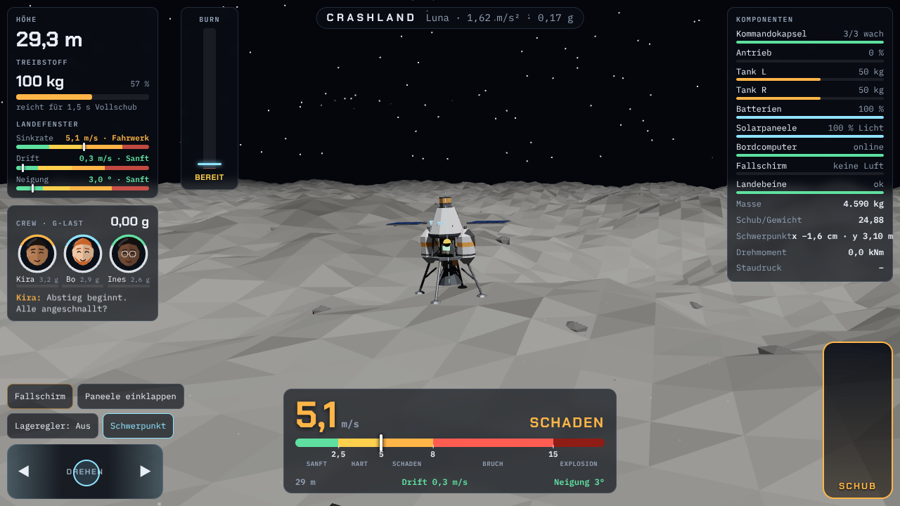

# Crashland

Low-poly lander game in the browser: **Three.js** (rendering), **cannon-es** (crash debris), **Blender** (assets, generated by script).



## Flight model

Full 3D: the lander moves in x/y/z and has two tilt axes (roll about z, pitch about x); thrust points along its axis. Wind can come from any direction, the start point lies upwind somewhere around the pad. Controls are relative to the camera, so "up" on the tilt pad always tips the lander away from you. Aiming aids on the ground: a ring right below the lander and a cross where it would hit if it kept falling; in the top-down view these and the pad are easy to line up.

## Idea (version 1)

Your lander falls toward a planet without power. Light the main engine as late as possible and only as long as needed: the **suicide burn**. Along the way:

- **Fuel**: loaded per mission (Luna 175 kg, Mars 305, Terra 200, Brontes 230). With a well-timed parachute plenty is left over (Terra ~40 %); without one it gets tight (Terra ~7 %). Burning early, hovering or correcting drift eats into that. Both tanks drain evenly; the mass drops during the burn, so the thrust-to-weight ratio rises.
- **Crew & g-load**: three crew members with their own tolerance: pilot Kira 3.2 g, engineer Bo 2.9 g, scientist Ines 2.6 g. Above that, strain builds up until they pass out; they come round again after a few seconds below the limit. If Kira passes out, nobody steers (no thrust, no attitude control). Anyone passing out costs a star. A late hard burn saves fuel but strains the crew; an earlier, gentler one costs fuel. The crew sits as low-poly helmet portraits in the HUD (`src/crew.js`) and reacts live: weightless in free fall, focused, strained (face pulled down, pale, sweating), unconscious, panicking when the ground comes too fast, cheering or dazed after landing. Speech bubbles on events; a grey-out vignette shows the pilot's strain.
- **Centre of mass**: computed live from all components (marker + thrust axis in 3D). If it sits off the thrust axis, the engine creates torque that attitude control has to compensate.
- **Power**: the battery feeds the flight computer, attitude control and the fuel pumps. Solar panels recharge depending on planet. Empty battery → computer offline, pumps off, max. 60 % thrust.
- **Atmosphere & parachute**: air density per planet (Luna none, Mars very thin, Terra normal, Brontes dense) slows the lander (drag, terminal velocity). The parachute (P / button) inflates over ~2 s and is reefed: the riser load is capped (~70 kN), so it never jerks harder than ~2.5 g and opens fully only as the lander slows down. Above 5.5 kPa dynamic pressure it tears. Air drag counts as g-load for the crew. On Terra you can deploy once the lander has slowed to terminal velocity; on Brontes its terminal velocity is already too fast for the canopy, so you have to brake with the engine first. It can be cut away again; on Luna it is useless.
- **Re-entry heat**: every component has its own temperature (heating ∝ √ρ · v³, game-scaled). The solar wings have heat capacity: on Terra they get critical within a few seconds of entry, the heat alert (from 50 %) leaves about 3–4 s to fold them in. Hot parts glow dark red → orange → yellow and shed sparks; above their limit they explode and break off, with consequences: solar panel → less charging, tank → its fuel is gone (and the centre of mass shifts), parachute pack → no parachute, computer → no attitude control or burn display, battery → no power, legs → no landing. On Terra the extended solar panels burn off during entry; fold them in (E / button, ~1 s, no charging while folded) and keep the lander upright, since tilting exposes one side more. The attitude controller only leans into the drift while the engine is firing.
- **Wind** (start menu: off / light / medium / strong / storm, score ×1.1 … ×1.8): the air moves sideways with gusts and is weaker near the ground (shear). Drag is computed against the airflow, so the lander drifts with the wind (under the parachute almost fully) and is tipped over by the side force acting above the centre of mass (more with the solar wings out). Cutting the chute low leaves you with the wind's drift, which you have to kill by leaning into it while burning; the retro attitude mode only leans up to 10°. The lander starts upwind so the wind carries it towards the pad; the HUD shows wind and the direction/distance to the pad plus a small radar compass (top-down, oriented like the camera: pad with its flat zone, where the wind comes from, your drift over the next 10 s), a light column marks the pad from afar, and a windsock stands next to it. No air, no wind (Luna).
- **Planets**: Luna (1.62 m/s²), Mars (3.71), Terra (9.81), Brontes (15.2: super-Earth, dense air, little thrust reserve).

The flat area around the pad has a radius of 70 m; landing outside it on hills fails because of the uneven ground.

Landing window (same on all planets). Below 80 m a slim gauge bar shows the sink rate on a scale with exactly these limits (glows red in the crash range):

| Grade | Sink rate | Drift | Tilt | Result |
|-------|-----------|-------|------|--------|
| Soft | ≤ 2.5 m/s | ≤ 1 m/s | ≤ 5° | landed ★★★ |
| Hard | ≤ 5 m/s | ≤ 2.5 m/s | ≤ 10° | landed |
| Damage | ≤ 8 m/s | ≤ 4 m/s | ≤ 18° | landed, landing gear buckles |
| Crash landing | ≤ 15 m/s (or tipped over) | | | legs and panels break off, hull topples, **no fire, crew survives** |
| Explosion | above that | | | tanks rupture; only the **remaining fuel** explodes (fireball scales with it). Crew survives up to 24 m/s unless a big fuel fire engulfs the capsule. No fuel, no explosion. |


## Orbit level (experimental prototype)

"Luna Orbit" in the planet menu starts on a circular orbit 1.5 km above a small moon (radius 10 km, orbital speed ~119 m/s), 6 km before the pad, with 430 kg of fuel. The attitude mode starts on **Retro**, which on this level points the engine fully against the velocity (any angle), and the throttle limit starts at 50 % (~2 g). The HUD counts down to the braking burn (`ORBIT … · BREMSEN IN … s`, then `JETZT BREMSEN`); burn until the orange cross reaches the pad, fall, then land as usual. In the sim, following the cue lands ~10 m from the pad with ~110 kg left; braking late overshoots, braking a few seconds early is forgiving.

How it works (kept separate so it can be removed again):
- **Physics** (`sim.js`): the flight model stays flat; `x`, `z` are arc length over the surface and `y` the height. `curvature()` adds gravity that falls off with height, centrifugal lift from horizontal speed and the shrinking arc rate. Only planets with `R` use it (`ORBIT_PLANET`); `predictImpact` uses the same terms. `orbitGuide()` gives the brake countdown, `setTerrainEdge()` fades the landing-zone relief out to the smooth sphere.
- **Moon surface** (`moon.js`): craters in three sizes (cells of 1.8 km, 500 m and 140 m, placed by an integer hash), rolling hills and darker maria outside the landing zone. The same relief exists twice, bit-identical: in JS for the flight model (`moonRelief`, used by `terrainHeight`) and in GLSL for the renderer, so you can land anywhere, crater walls included.
- **Rendering / level of detail** (`world.js`, `moon.js`): the moon is one mesh and one draw call, a polar grid (~42k triangles) that rides under the lander: about 3 m cells below it, growing by 4.5 % per ring out to the far side. The vertex shader bends it onto the sphere and displaces it; each crater size fades out where the grid gets too coarse to draw it. The grid recentres in steps (4/16/64 m depending on altitude) so the vertices don't swim. Each frame `align()` turns the moon so the point below the lander sits under it, so the lander, camera and HUD keep using flat coordinates; `toRender()` maps ground markers. A low sun (~20°) gives the craters lit rims and shadowed bowls.
- **Removing it**: drop `ORBIT_PLANET` from the menu list in `main.js`; everything else is inert for the normal planets.

## Controls

| Key | Touch / mouse | Function |
|-----|---------------|----------|
| Space (hold) | **Throttle lever** (right): touching = burn, height = thrust (top = 100 %) | Main engine |
| + / −, 1 … 0 | throttle lever | Thrust limiter (0 = 100 %) |
| W A S D, arrows | **Tilt pad** (left, four-way): press towards where you want to tip; up = away from the camera; further out = faster | Tilt (RCS) on both axes, relative to the camera |
| P | Fallschirm | Deploy / cut away the parachute |
| E | Paneele | Fold the solar panels in / out |
| T | Lageregler | Attitude control: **Hold** (default) / Retro / Retro 2 / Vertical / Off |
| C | Schwerpunkt | Show centre of mass and thrust axis |
| V | Ansicht | Camera: behind / oblique / target / top-down (screen-up always matches the tilt pad) |
| R / M | buttons | Restart / planet select |
| – | drag / swipe on the 3D scene | Orbit the camera around the lander: sideways = around, up/down = higher or lower (from above to slightly below); double tap / double click resets the height; wheel = zoom |

Lever and rotate pad each track their own touch point, so both work at the same time with two thumbs. The layout adapts to desktop, phone portrait and phone landscape.

The flight computer's burn point includes air drag and the parachute and adds a reaction reserve (~15 % + about 1 s of descent); the countdown before it is a short look-ahead with drag.

### Precision landing

- The orange cross (on the ground and in the compass) is a real prediction of the touchdown point without thrust: gravity, drag, wind with shear and the current canopy are integrated forward (`predictImpact`). Bring it onto the pad.
- Under an open parachute the tilt pad steers the canopy: it glides up to 5 m/s through the air in the pressed direction.
- Without air, a short tilted burn high up moves the cross.
- With **Retro 2** the pad is a velocity command while burning (up to 8 m/s over ground, less near the ground); let go and the drift is stopped.
- The result shows the distance to the pad centre; ≤ 3 m is a bull's-eye (+300 points), on the pad (≤ 12 m) +150.

Measured with a sim pilot that only uses these aids: Luna ~4 m, Mars without wind 1–4 m, Terra without to strong wind 2–6 m from the centre (10/10 landed); without aiming the same flights end 35–65 m away.

### Camera views

- **Hinten**: chase camera beside/behind the lander.
- **Schräg**: behind and above, about 50° down, so the ground ahead is visible.
- **Ziel**: starts close on the lander, then pulls back over ~3 s to frame the lander and the predicted touchdown point together. When the lander is only a few pixels tall, a bobbing arrow marks it (in every view).
- **Oben**: straight down.

The ground ring and cross are drawn on top of everything; in the downward views the canopy turns see-through.

### Attitude control

- **Hold** (default, like the Apollo LM's attitude hold with rate command): the rotate pad / A–D sets a turn rate (up to ~23°/s, proportional on the pad); let go and the computer stops the rotation and holds that angle, with an integral term against steady wind torque.
- **Retro**: holds upright in free fall, leans up to 10° against the drift while the engine is firing.
- **Retro 2** (experimental, to compare; the tilt pad sets the ground velocity while burning): surface-retrograde. In free fall the thrust axis points against the velocity over ground; while burning it leans so the thrust kills the ground drift (with a short lead for the attitude lag) and holds against the current wind force (feed-forward from the measured air drag), up to 20°. Under an open parachute it hangs straight. In the sim it lands Terra in a storm with ~1 m/s drift from every wind direction where Retro drifts 4–8 m/s.
- **Vertical**: always back to 0°.
- **Off**: the pad fires the jets directly; a rotation keeps going until you counter it (as in vacuum).

Attitude control needs the flight computer and power; without them it is always "off".

## Structure

- `src/sim.js`: flight model (pure, no three.js; runs in node for balancing): components, masses, centre of mass, fuel, power, g-load, touchdown
- `src/ship.js`: assembles the lander from the component models, engine flame, centre-of-mass marker
- `src/world.js`: terrain, landing pad, sky, stars, dust
- `src/debris.js`: crash: components fly apart with cannon-es physics
- `src/hud.js`, `src/style.css`: cockpit HUD
- `blender/build_assets.py`: all low-poly models (capsule, engine, frame, tank, solar, computer, battery, legs, rock)

## Start

```bash
npm install
npm run dev        # dev server at http://localhost:5173
npm run build      # static build in dist/ (models are embedded in the JS)
npm run assets     # rebuild the models with Blender → src/assets/*.glb
```

(Blender's glTF exporter needs numpy; on Debian/Ubuntu: `apt install blender python3-numpy`.)
